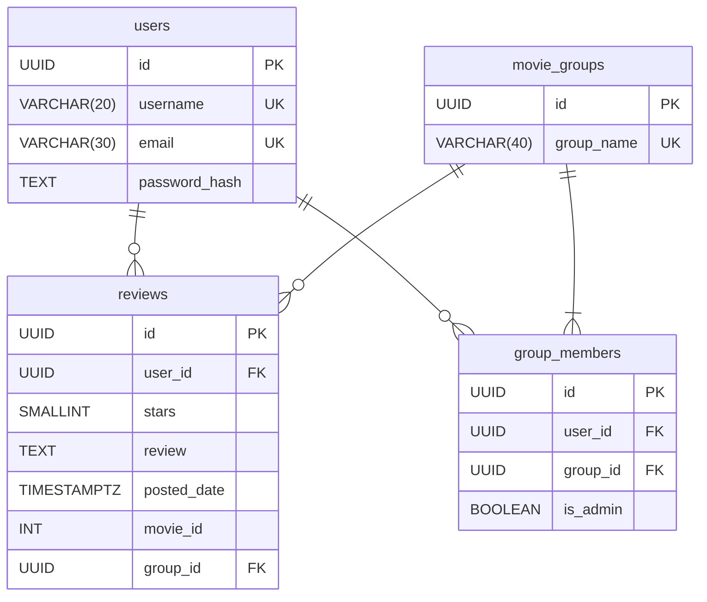
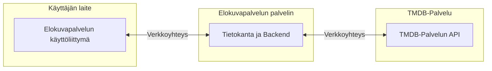

# Tekninen määrittely

## Arkkitehtuuri

Sovelluksen pääosiin kuuluu React-frontend, Express-backend, Postgres-tietokanta, Azure-palvelin, Vitest-testit ja Playwright-testit.  
Ilari Bäckmanin vastuualueisiin kuuluu Vitest-testit, Playwright-testit ja Postgres-tietokanta.  
Daniel Nylanderin vastuualueisiin kuuluu Express-backend ja Azure-palvelin.  
Jarkko Huhtalan vastuualueisiin kuuluu React-frontend.

Yleiskuvaus:

Elokuva-harrastajasovelluksen Reactilla tehty Single Page Application -käyttöliittymä lähettää pyyntöjä Express-backendiin, joka välittää pyynnöt eteenpäin Postgres-tietokantaan tai The Movie Database API-rajapintaan. Käyttöliittymä ja backend toimivat samalla Azure-palvelimella. Jokaiselle komponentille on olemassa Vitest-yksikkötestejä ja -integraatiotestejä sekä Playwright-testit.

## Teknologia ja perustelut

Ohjelmointikielenä toimii JavaScript, koska projektiryhmä on opetellut sen käyttöä.  
Sovelluksessa käytetään React-frontendiä, Express-backendiä, Azure-palvelinta ja GitHub-alustaa, koska ne ovat määrätty projektiryhmälle käytettäväksi.  
Sovelluksessa käytetään Vitest-testejä, koska projektiryhmä on opetellut niiden käyttöä.  
Sovelluksessa käytetään Postgres-tietokantaa ja Playwright-testejä, koska projektiryhmää on ohjeistettu niiden käytöstä.  
Sovelluksessa käytettyt kirjastot ja niiden versiot löytyvät tarkemmin [package.json](../package.json) tiedostosta.

## Tiedot ja rajapinnat

### ER-Malli

(Täydennetään myöhemmin tarvittaessa)

### Käyttöönottokaavio

(Täydennetään myöhemmin tarvittaessa)

Elokuvapalvelu tarjoaa selaimeen API-rajapinnan, jolla voi kutsua backendiä. Nykyisessä API-rajapinnassa on login ja register POST reitit. Niitä kutsutaan lähettämällä JSON, jonka esimerkit on jokaiselle reitille määritelty tarkemmin [userRoutes](../api/routes/userRouter.js) tiedostossa.

Tietokohteet, -suhteet lisätään tähän myöhemmin.  
Palvelu muodostaa yhteyden The Movie Databasen API-rajapintaan.

## Laadun tekniset ratkaisut

Käyttäjät tunnistautuvat palveluun käyttäjänimen tai sähköpostin ja salasanan avulla. Salasanasta muodostetaan yksisuuntainen tunniste bcrypt kirjaston avulla.  
Käyttöoikeudet tarkistetaan cookiehen tallennetun JWT-authtokenin avulla.  
Tietojen validointi suoritetaan backendissä controllereissa. Niissä tarkistetaan, että tieto on oikeassa muodossa ja kaikki tarvittava tieto on syötetty.  
Virheenkäsittely suoritetaan backendissä middlewarella ja frontendissä tarvittaessa.  
Suorituskyky testaan testityökaluilla ja selaimen devtoolseilla. (Tarkennetaan myöhemmin)

## Kehitys ja käyttöönotto

Kehitysympäristönä toimii Vite joka suoritetaan Docker-kontissa.  
Testaukseen käytetään vitestiä.  
Tuotantoympäristönä toimii GitHubiin CI/CD-putkella liitetty Azure-palvelin.  
Sovellus on jatkuvasti käynnissä Azure-palvelimella. Kehitysympäristön käynnistys toimii Dockerin tai vastaavan ohjelman avulla.  
Automaattiset testit tehdään Vitest- ja Playwright-ohjelmilla ja suoritetaan mahdollisimman usein.
